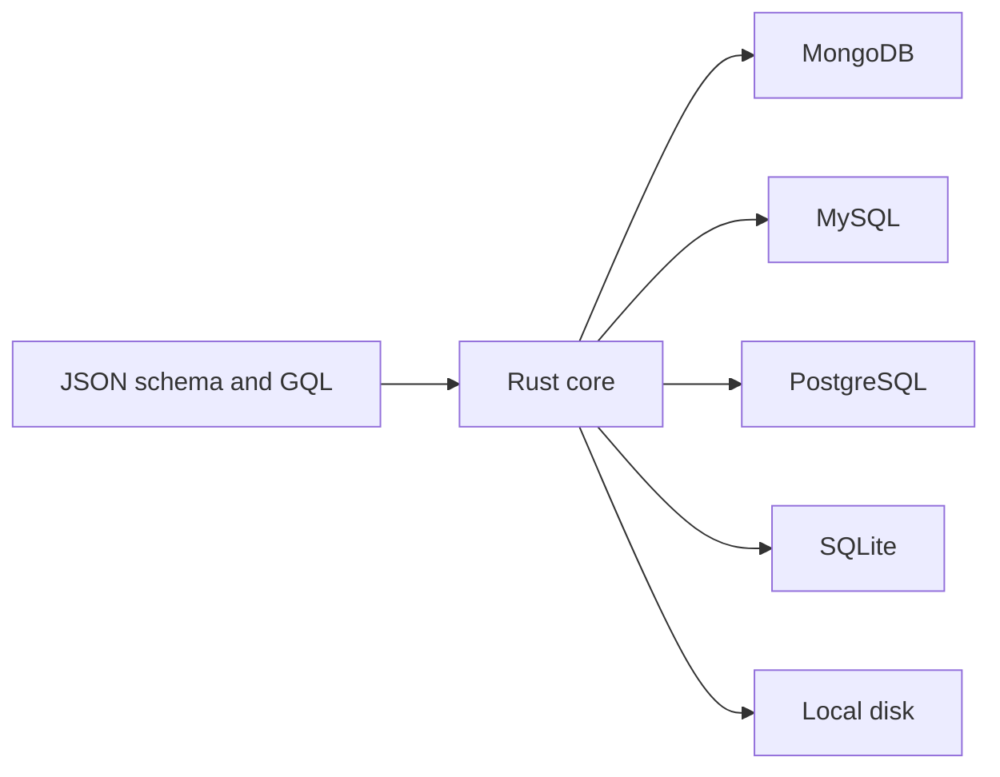

# py-store

**The Python asyncio host for a shared Rust data core: one JSON schema and one MongoDB-flavoured GQL, compiled to native MongoDB aggregation or parameterized SQL for MySQL, PostgreSQL and SQLite — plus a local-disk backend with no database at all.**


> Distribution name `storepy`, import package `py_store`. Python 3.10+, backed by `rust-store-py>=5.3.0,<6.0.0`.

> 中文: [README.md](./README.md)

---

## The migration that starts with 400 queries

The team is moving a learning platform from MySQL to PostgreSQL. The inventory is small — eight collections — but the SQL is not: roughly 400 hand-written statements, some with `DATE_FORMAT`, some with `GROUP_CONCAT`, a few with `INSERT ... ON DUPLICATE KEY UPDATE`. The first estimate is a full rewrite, followed by a second pass because the reporting queries do not fail loudly; they just return slightly different numbers. Worse, from then on every new report needs two query strings, two reviewers and two staging runs.

The rewrite is the wrong unit of work. The team deletes the 400 SQL strings and writes eight schema dicts. The 400 statements become 400 GQL trees — written once, then executed against MySQL in staging and PostgreSQL in production without a second dialect. The same code runs against MongoDB for a customer who insists on it, SQLite for the test suite, and a local directory for the demo laptop.

That is the promise of this repo: **one schema, five backends, one query language**. The Python package is the host layer; the parsing, permission checks, computed columns, command planning and SQL dialect translation all live in the shared Rust core `rust-store`.

## What it actually does

A model is a JSON dict: `fields`, `relations`, `computes`, `indexes`, `read` / `write` whitelists. From that dict the core derives query plans, write plans, permission decisions, archive tables and DDL text. The Python host owns driver IO and callback dispatch; the semantics stay in the core.

| Surface | What you get |
| --- | --- |
| Schema | pure JSON fields, relations, computed columns, indexes, role whitelists, `ownerKey`, `default` |
| Reads | GQL tree → one native query; nested `one` / `many` relations; `$group` / `$having`; count and exists |
| Writes | `insert`, `insert_many`, `update`, `update_many`, `upsert`, `mutation`, `remove`; defaults; triggers |
| Access | schema- and field-level whitelists, `creator` ownership, owner-condition injection, fail-secure context |
| Runtime | MongoDB, MySQL, PostgreSQL, SQLite, local disk; transactions, sessions, opt-in raw SQL / native pipeline |
| Not here | model classes, a general migration engine, distributed transactions, a raw-pipeline escape hatch |

## How it works

### One parse, three artifacts

Every read starts the same way: GQL text plus a params dict becomes an AST, the AST becomes a backend-neutral command JSON, and only then does a dialect render it. The Rust core never opens a socket. `store.build_pipeline(...)` exposes the middle step if you want to inspect or explain a plan without executing it.

This split is why the Node.js host can share the same semantics: there is one parser, one permission engine, one planner. A behaviour fix cannot land in Python and silently miss JavaScript.

### Relations resolve in one native query per backend

Declare a relation once:

```json
"relations": {
  "lessons": { "model": "Lesson", "type": "many", "localField": "_id", "foreignField": "courseId" }
}
```

On MongoDB the core emits a single aggregation with `$lookup`; on MySQL, PostgreSQL and SQLite it emits one SQL statement with a chain of `LEFT JOIN`s. Per-parent `$sort` / `$skip` / `$limit` become window functions on SQL, so each parent gets its own top-N rather than a global trim. Flat join rows are then rehydrated into nested documents by the core, including the difference between an absent field and an explicit `null` (tracked by a `__present` sentinel column). You never write `$lookup` or `JOIN` by hand, and a detail page does not turn into N+1 queries.

### Computed columns: push down when possible, call back when not

There are two kinds, and the schema decides which:

- **Relation aggregates** (`{"agg": {"$count": "lessons"}}`) compile into the same native query — a derived table grouped by foreign key and joined back onto the parent on SQL, a lookup-and-count on MongoDB. The database does the work.
- **Callback columns** (`fn` / `asyncFn` with a `fnRef`) are executed by the host after the rows are fetched, with their `depends` fields available. Use them when the value needs application logic or an external service.

Computed columns are read-time views. They are not stored columns, and they do not drift: the plan and the rehydration pass live in the same core as the query.

### Writes: permission, defaults and archive before the row leaves

Three decisions happen before a write reaches a driver.

**Permission.** Schema-level and field-level whitelists are evaluated by the core. `creator` is a pseudo-role resolved from data, not from the role list: a document matches when `doc[ownerKey] == ctx.userId` (the key defaults to `createdBy` and is overridable per schema). When `creator` appears in `read` or `write`, registration adds the ownership field to the schema, and DDL generation adds the corresponding column automatically. Creator-only reads get an owner condition `AND`-merged with yours — never substituted for it — so an empty filter still cannot read another user's rows.

**The write probe has three outcomes.** A write that cannot be fully authorized from the request alone is planned as a probe: the core first returns `needsProbe`, the host executes the probe, then replays the plan:

- the row exists and is yours → the write proceeds;
- the row does not exist → `ERR_NOT_FOUND`, surfaced as a `RuntimeError` whose `code` is `not_found` and whose message keeps the sentinel prefix. This is deliberately **not** a permission error, so callers can map it to 404 instead of telling the user to ask an administrator;
- the row exists but is not yours → the original permission message, wrapped in `PermissionError` with the `ERR_PERMISSION:` prefix stripped and nothing else rewritten.

**Defaults and soft delete.** A declared `default` is merged into the document **before** it is persisted. An explicit value wins; an explicit `null` is preserved; a field with no declared default stays absent rather than being filled with a type zero. Every registered model also gets a derived `<Name>Deleted` archive by default (`<collection>_deleted` with a `deletedAt` field); `remove()` archives the row first, then deletes it.

## Run it

```bash
pip install storepy
```

SQL drivers are extras: `pip install "storepy[mysql]"`, `"storepy[postgres]"`, `"storepy[sqlite]"`. The local-disk backend needs no extra and no server.

The example below is a trimmed version of the `Course` and `Lesson` models in `example/course-platform/schema.json`, run on the local-disk source so it is self-contained:

```python
import asyncio
import tempfile

from py_store import init, local, store

COURSE = {
    "name": "Course", "collection": "courses", "idPrefix": "c", "timestamps": False,
    "read": ["student", "teacher"], "write": ["creator", "admin"],
    "fields": {
        "_id": {"type": "string"},
        "title": {"type": "string"},
        "status": {"type": "string", "default": "draft"},
        "price": {"type": "float"},
    },
    "relations": {
        "lessons": {"model": "Lesson", "type": "many",
                    "localField": "_id", "foreignField": "courseId"},
    },
    "computes": {"lessonCount": {"type": "int", "agg": {"$count": "lessons"}}},
}

LESSON = {
    "name": "Lesson", "collection": "lessons", "idPrefix": "l", "timestamps": False,
    "read": ["student", "teacher"], "write": ["creator", "admin"],
    "fields": {
        "_id": {"type": "string"},
        "courseId": {"type": "string"},
        "title": {"type": "string"},
        "seq": {"type": "int"},
    },
    "relations": {},
}

async def main():
    workdir = tempfile.mkdtemp()
    store.register(COURSE)
    store.register(LESSON)
    await init({"default": local.connect({"dir": workdir})})

    store.set_context({"userId": "u1", "roles": ["teacher"]})
    course = await store.insert("Course", {"title": "Rust for Python devs", "price": 99})
    await store.insert("Lesson", {"courseId": course["_id"], "title": "Ownership", "seq": 1})
    await store.insert("Lesson", {"courseId": course["_id"], "title": "Traits", "seq": 2})

    rows = await store.query(
        "Course($condition:@c,$sort:@s){"
        " _id, title, status, createdBy, lessonCount,"
        " lessons($sort:@s){ title, seq } }",
        {"c": {"_id": course["_id"]}, "s": {"seq": 1}},
    )
    print(rows[0]["status"], rows[0]["createdBy"], rows[0]["lessonCount"],
          [l["title"] for l in rows[0]["lessons"]])

asyncio.run(main())
```

Output: `draft u1 2 ['Ownership', 'Traits']`. The status came from the schema default, `createdBy` from the context, `lessonCount` from the pushed-down relation aggregate, and the two lessons from the nested relation — all in one query.

To run the full eight-model matrix, use the repo's scenario harness. MongoDB runs first and records the oracle; the SQL backends then replay it row by row:

```bash
python example/course-platform/impl/harness.py --backend mongodb --out .out/mongodb.json
python example/course-platform/impl/harness.py --backend sqlite --out .out/sqlite.json --oracle .out/mongodb.json
```

An unreachable backend is reported as `available: false` with a `skip_reason` — it is never silently counted as a pass. The behaviour matrix is the test suite: `test_parity_local.py`, `test_parity_deny.py`, `test_require_context.py`, `test_scenario_course_platform.py` and `test_real_backends_e2e.py` each pin one slice of it.

## Normative excerpts

Three contracts are normative — directory-to-location resolution, naming translation, and `fnRef` binding. They are reproduced verbatim here and checked against every carrier in CI (`scripts/check-spec-snippets.js`).

<!-- SPEC:LOCATION:BEGIN -->
### Location: directory semantics + connection config (definitions carry no location)

A schema definition file contains no location fields (no `source` / `database` / `schema`; `namespace` is removed). Location is resolved from the definition directory layout plus the connection config:

- Under the definitions root `<defs-root>/`: the first directory level is the `database`; PostgreSQL adds a second level for `schema` (Mongo / MySQL / SQLite have no such level); deeper levels are free-form and flattened at load time (no hierarchy semantics).
- The connection config (`store.config.json`) declares `sources` (`kind` + `databases`) and `defs`; `kind` decides whether that database directory is read one level deeper for `schema`.
- Location fields are `source` / `database` / `schema` (PG only) / `collection`; the word `namespace` is removed.
- Same-named schemas: exactly one primary (no `replica`); the rest declare `{ "name": "...", "replica": true }`, add only a link, and must not repeat the structure. Zero or two-or-more primaries is an error.
- A duplicated `name` within one load batch is an error and the service does not start; re-loading the same `name` across versions bumps its version by 1.
- Writes are synchronized within a single connection, across the primary plus all links, in one transaction; a write spanning a cross-connection link is explicitly rejected or degraded with a feedback event (never silent).
<!-- SPEC:LOCATION:END -->

<!-- SPEC:NAMING-STYLE:BEGIN -->
### Naming: freeform definitions, system-directed translation

Definitions (`collection`, fields, referenced relation fields, computed-column keys, `fnRef` values, index names) may use any style; the engine translates them to the target style. Contract keys (`fnRef`, `localField`, `foreignField`, `asyncFn`, `type`, ...) and the schema `name` are never translated.

| Target | Style | Example (`orderTotal`) |
|---|---|---|
| MySQL / PostgreSQL / SQLite (physical) | snake_case | `order_total` |
| MongoDB (physical) | camelCase | `orderTotal` |
| Node.js / Java / C# / Rust (code; computed columns follow) | camelCase | `orderTotal` |
| Go (code; computed columns follow) | PascalCase (must be exported) | `OrderTotal` |
| Python (code; computed columns follow) | snake_case | `order_total` |

Canonicalization (single implementation `core::naming`, re-exported by the bindings; hosts must not re-implement it): split on `_`, `-`, `.`, space and at lower/digit-to-upper boundaries; a trailing uppercase in a run followed by a lowercase starts the next token (`HTTPServer` -> `[http, server]`, `userID` -> `[user, id]`); digits stay inside a token (`order2Items` -> `[order2, items]`). Reassembly: snake = `t1_t2`, camel = `t1T2`, pascal = `T1T2`.

Two logical names in one schema that canonicalize equal (`orderTotal` vs `order_total`) is an error `ERR_NAME_CONFLICT:` and the service does not start (never silently overwritten). The `fields` key space is fully open — no field name is reserved: contract keys (`type`, `default`, ...) live inside a field's definition object at a different level, so `fields: { type: { type: "string" } }` is valid. Literal reserved names are only `_id` (framework primary key) and `_score` (vector score column).
<!-- SPEC:NAMING-STYLE:END -->

<!-- SPEC:FNREF:BEGIN -->
### Computed columns: `fnRef` binding by composite name + canonical match

Computed columns live at the schema top level, `computes: { <key>: { type, fn | asyncFn | agg, fnRef?, depends?, read? } }` (`fn` / `asyncFn` / `agg` are mutually exclusive).

- The logical `fnRef` defaults to `<schema.name>.<computed-column key>` (generated, never hand-written); since `name` is globally unique, the `fnRef` is globally unique too.
- Host implementations bind by canonicalization: both the implementation's name in the host language style and the schema's logical `fnRef` are canonicalized to token sequences and compared. So Node's `orderAmountLabel` and Python's `order_amount_label` bind to the same logical computed column.
- Reusing one implementation across schemas: write an explicit shared name (e.g. `"fnRef": "common.moneyLabel"`); naming goes from required to optional.
- Every declared `fnRef` must have an implementation, otherwise the service fails to start with `ERR_FN_MISSING`.
<!-- SPEC:FNREF:END -->

## Boundaries: when not to use it

- **You want an ORM with model classes and a migration engine.** py-store models are runtime dicts, chosen so the same definition runs in Python and Node.js. `generate_ddl()` renders `CREATE TABLE` text and `migrate()` orchestrates a whitelist of changes (add table / column / index, widen types); neither replaces Alembic or Django migrations.
- **You need an arbitrary aggregation pipeline as a normal path.** User `$pipeline` passthrough was removed and now fails explicitly. `store.aggregate()` exists only as a strictly opt-in alias, disabled by default, and when enabled it skips GQL permission filtering and computed-column rehydration.
- **You need real concurrency on the local-disk backend.** It is single-process (in-process writes are serialized by a directory lock), capped at 100,000 documents per collection with an explicit error, and has no indexes — declaring `schema.indexes` emits a `local_indexes_ignored` feedback event.
- **You need a distributed transaction across two data sources.** A session that writes to more than one source rolls everything back and raises `NonAtomicWriteError`; it never commits half a unit of work. There is no two-phase commit.
- **You need Mongo for task claiming or compare-and-swap.** `claim` / `compare_and_set` are SQL-only and refuse a Mongo source with `concurrencyPrimitivesSqlOnly`; faking them with `find_one_and_update` would not be atomic.

## Where it sits in the family

`py-store` is the Python host; the logic lives one layer down. The shared core and its PyO3 binding are in [rust-store](https://github.com/coenddt/rust-store), the JavaScript host with the same schema and GQL is [nodejs-store](https://github.com/coenddt/nodejs-store), and this repository is [py-store](https://github.com/coenddt/py-store). The HTTP, GraphQL, gRPC and MCP skins sit on top of a host, not on top of a driver.

## At a glance


